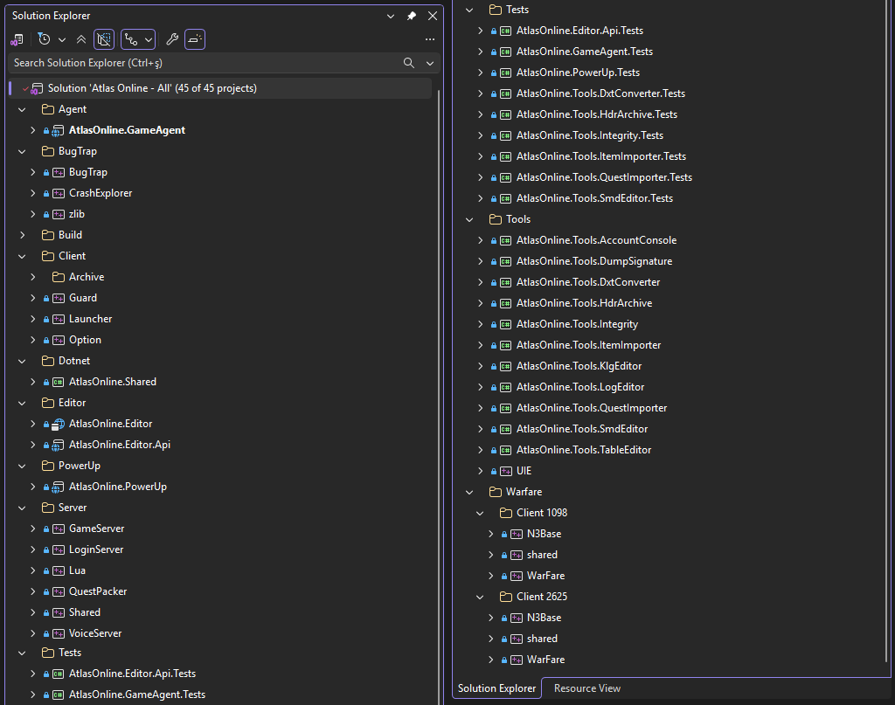
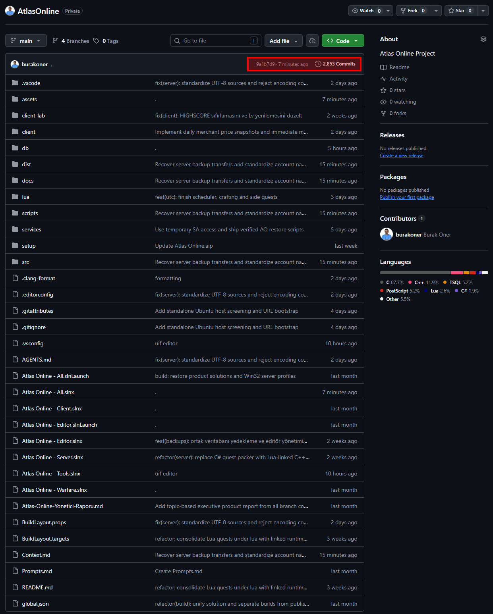
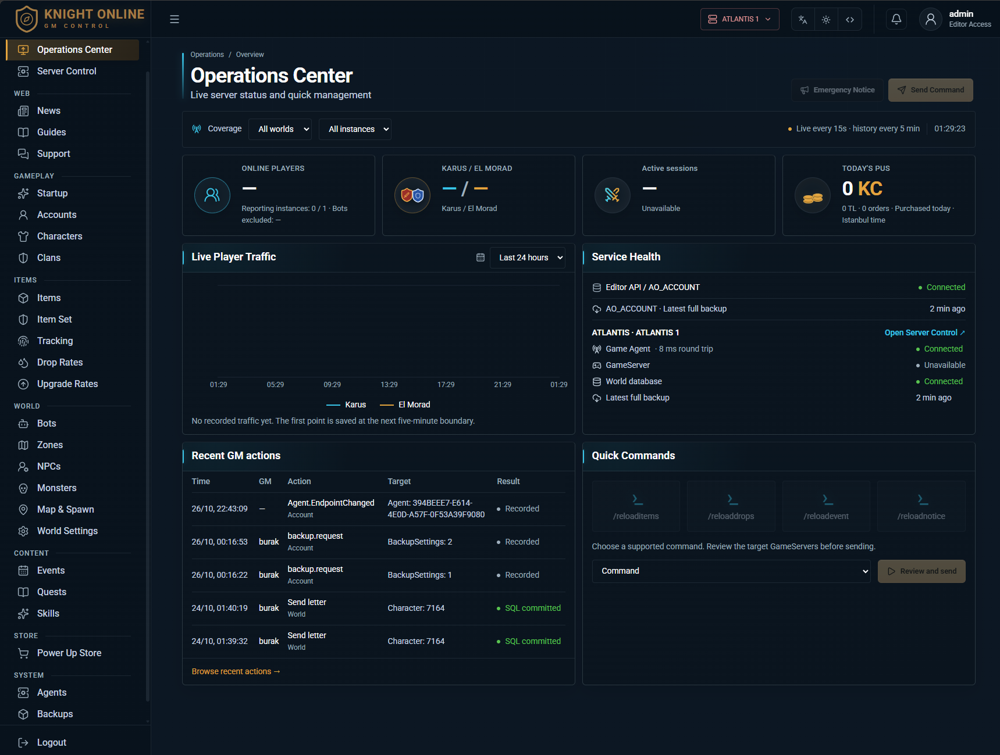
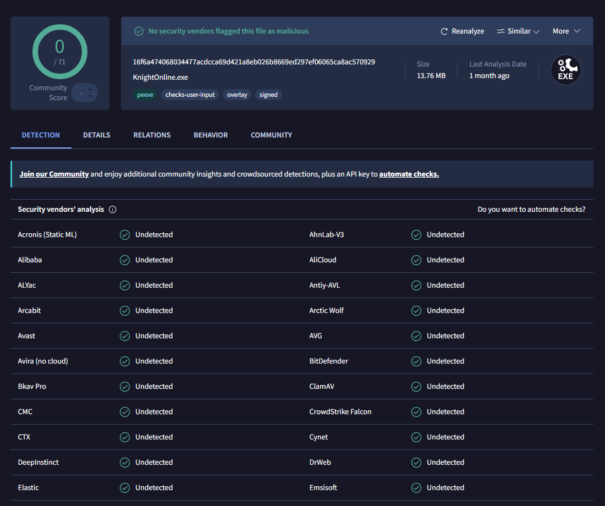
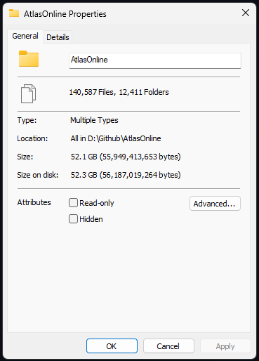

# Knight Online 2625

**Orijinal Knight Online 2625 için sunucu, client ve araç kaynak kod projesi.**

**52 GB geliştirme alanı · 2.853 commit · 45 proje**

Önce çalışırken görün. Sunucuyu kendi bilgisayarınızda kurun, orijinal NTTGame istemcisiyle oyuna girin ve test edin. Kaynak kodlara erişim için doğrudan benimle iletişime geçin.

Bu depo **derlenmiş yerel test paketini** içerir. Ana kaynak kod deposu özel tutulmaktadır; 52 GB ve 2.853 commit bilgileri o geliştirme alanına aittir.

| Klasör | İçerik |
| --- | --- |
| [`database/`](database/) | AO_ACCOUNT ve AO_SERVER_01 tam veritabanı yedekleri, SHA-256 listesi. |
| [`server/`](server/) | LoginServer, GameServer, VoiceServer ve çalışma dosyaları. |
| [`client/`](client/) | Orijinal istemcinin üzerine kopyalanacak dosyalar. |

## Sunucuyu kurun

1. **64-bit Windows**, **SQL Server 2022 veya üzeri**, SQL Server Management Studio ve **Microsoft ODBC Driver 17 for SQL Server — x64** kurun.
2. [`database/`](database/) içindeki `.bak` dosyalarını SSMS üzerinden **AO_ACCOUNT** ve **AO_SERVER_01** adlarıyla restore edin. Restore ekranında veri/log dosyalarının yollarını kendi SQL Server klasörünüze uyarlayın.
3. **ODBC Data Sources (64-bit)** uygulamasını yönetici olarak açın:

   ```text
   C:\Windows\System32\odbcad32.exe
   ```

   **System DSN → Add → ODBC Driver 17 for SQL Server** yoluyla iki bağlantı oluşturun. Sunucu adresi olarak kendi SQL Server instance'ınızı, kimlik doğrulama için SQL kullanıcı adı/parolanızı kullanın:

   | System DSN adı | Varsayılan veritabanı |
   | --- | --- |
   | `AO_ACCOUNT` | `AO_ACCOUNT` |
   | `AO_SERVER_01` | `AO_SERVER_01` |

   **İki DSN de 64-bit olmalı. 32-bit ODBC tanımları bu sunucular için çalışmaz.** Her iki bağlantıda **Test Data Source** sonucunun başarılı olduğunu görün.

4. `server/LoginServer.ini` ve `server/GameServer.ini` dosyalarındaki `[ODBC]` bilgilerini düzenleyin:

   | Dosya | Bağlantı |
   | --- | --- |
   | `LoginServer.ini` | `DSN=AO_ACCOUNT`; `UID` ve `PWD` kendi SQL kullanıcı adı/parolanız. |
   | `GameServer.ini` | `ACCOUNT_DSN=AO_ACCOUNT`, `GAME_DSN=AO_SERVER_01`; ilgili `ACCOUNT_UID/PWD` ve `GAME_UID/PWD` değerleri kendi SQL bilgileriniz. |

5. `server/` klasöründen **LoginServer.exe → VoiceServer.exe → GameServer.exe** sırasıyla başlatın.

**Paket yalnız `127.0.0.1` üzerinde yerel test için hazırlanmıştır.** `AO_ACCOUNT.dbo.GAME_SERVERS` tablosundaki `InstanceIp` değerleri ve `VoiceServer.ini [NETWORK] BIND / LINK_BIND` değerleri `127.0.0.1` olmalıdır.

## Client ile oyuna girin

1. [NTTGame'nin resmî sayfasından](https://www.nttgame.com/knight/en/guide/installation) **orijinal Knight Online client'ini** indirip kurun.
2. Bu depodaki [`client/`](client/) klasörünün **içindeki dosyaları**, kurduğunuz oyunun ana klasörüne kopyalayın; aynı adlı dosyaları değiştirin.
3. `Server.ini` içindeki `[Server] IP0=127.0.0.1` değerini koruyun ve paketten gelen **Launcher.exe** ile başlayın.

## Tek çözümde 45 proje



## 2.853 Commit Geliştirme Geçmişi



## Web Tabanlı GM Kontrol Panel



## Client Güvenliği: VirusTotal 0/71

**Referans client dosyasının paylaşılan taramasında 71 güvenlik motorunun hiçbiri zararlı yazılım tespit etmedi.** Sonucu doğrudan inceleyin:

[VirusTotal raporunu açın](https://www.virustotal.com/gui/file/16f6a474068034477acdcca69d421a8eb026b8669ed297ef06065ca8ac570929)



Rapor, belirtilen imzalı dosyanın SHA-256 kimliğine aittir; paketteki tüm dosyalar için toplu tarama sonucu değildir.

## Kaynak Projenin Ölçeği

Sunucu, Guard, Launcher, editörler, araçlar ve testler aynı geliştirme alanında. Aşağıdaki görseller ana projenin paylaşılan geliştirme görünümüdür.

**52 GB geliştirme alanı**



## Test edin. Kaynak kodlara erişim için iletişime geçin.

Paketi kurun, sistemi deneyin. Kaynak kodlara erişim, kurulum ve proje hakkında görüşmek için doğrudan ulaşın:

**Burak Öner**

- **Telefon:** [0532 350 0682](tel:+905323500682)
- **E-posta:** [info@burakoner.com](mailto:info@burakoner.com)
